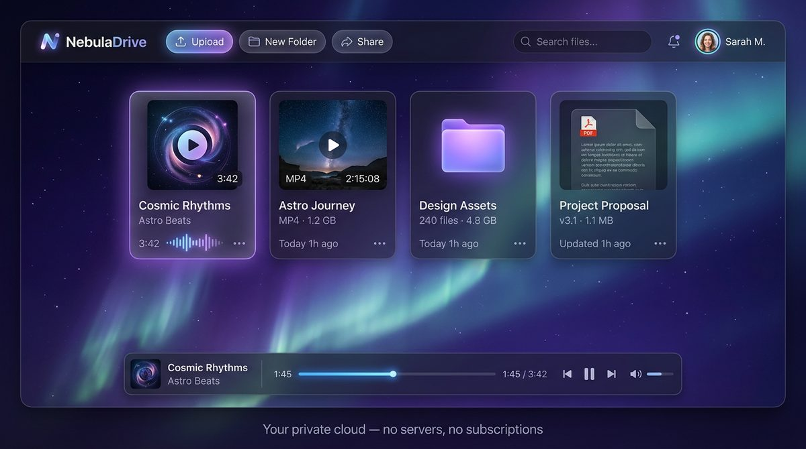

# ☁️ NebulaDrive (Beta)

### Your private Drive — always with you, no servers, no subscriptions.



> **Preview above** — the real thing is a single web page that runs entirely on your device. Everything you see here is local.

One HTML file. Open it in your browser and you've got a full-featured personal cloud. Everything stays on your device — nothing is ever sent anywhere. Built with vanilla JavaScript, OPFS, and IndexedDB. Made by **makerxm800**.

A few small sidecar files (`manifest.webmanifest`, `sw.js`, and PNG icons — `icon-192.png`, `icon-512.png`, `apple-touch-icon.png`, plus `preview.jpg`) make it installable as a real app — the HTML still works standalone if you only copy that one file.

---

## 🌟 What is it?

A personal cloud that runs entirely in your browser. Upload, organise, play, and back up your files — all stored locally. No sign-ups, no subscriptions, no strings attached.

- 🔒 **100% local** — no tracking, no analytics, no server calls
- ⚡ **OPFS + IndexedDB** — fast binary storage with automatic chunking fallback
- 🎬 **Built-in media player** — audio & video with PiP, speed control, trimming, precise seeking, and premium animations
- 🎨 **30 themes + Liquid Glass** — 11 standard + 19 premium, plus a site-wide glass effect toggle
- 💾 **Backup & restore** — real `.zip` archives with progress tracking and cancel support
- ✨ **Premium UI everywhere** — smooth expo-out motion (no bouncy overshoot), staggered entrances, soft accent shimmer instead of white shine, **ripple feedback on every button**, shimmer sweep on hover, deeper card lifts, and a springy modal entrance
- 🎯 **Details that feel right** — spring-smooth button hovers, press snap, keyboard ripple, smooth themed scrollbars, and a full `prefers-reduced-motion` fallback so nothing moves when you don't want it to
- 📱 **Install as an app** — web manifest + service worker + Apple touch icon, so **Add to Home Screen** on iPhone gives you a full-screen NebulaDrive app with its own icon (the home-screen name is **NebulaDrive**)
- 🚀 **Animated boot logo** — every open/reload plays a spring-free logo build (tile scales in, cloud rises, arrow draws, wordmark letters stagger) over a drifting aurora, then hands off to the app with a soft reveal
- 🌐 **8 languages + flag chips** — globe button opens a centered menu with real CSS-drawn flag chips per language (offline-safe, no emoji); welcome picker matches. Everything switches instantly and remembers your choice
- 🧭 Hit the **Tour** button for a showtime walkthrough: spotlight beam, directional card slides, shimmer progress, clickable step dots

---

## 📊 Details & specs

Everything the app promises, in one place — so there are no surprises:

| Detail | What it means for you |
|---|---|
| 📦 **One file, zero build** | Just `index.html` — no npm, no framework, no dependencies. Double-click and go. |
| 🧠 **Storage engine** | OPFS (Origin Private File System) with automatic chunked fallback via IndexedDB for browsers without OPFS. |
| 🗄️ **Data location** | Files live in your browser's local storage on your device. Export a ZIP backup anytime — nothing goes to any server. |
| 🖥️ **Device support** | Responsive across phones, tablets and desktops; touch-safe menus, big tap targets, safe-area insets on iOS; landscape and portrait both fine. |
| 🎨 **Themes** | 11 standard + 19 premium palettes, site-wide **Liquid Glass** toggle, per-account theme memory. |
| 🌐 **Languages** | English, Español, Français, Deutsch, Português, हिन्दी, العربية, 中文 — instant switching, remembered per account. |
| 🎬 **Media** | Audio + video player with PiP, speed (0.25×–2×), repeat, volume boost, stable volume, ambient mode, lyrics (`.lrc`), scrub preview, cinema mode, video cutting. |
| 🔐 **Accounts** | Local accounts + Guest mode; per-account avatars, banners, display names, statuses and icons. |
| 💾 **Backup** | Real `.zip` archives (stored locally) with progress, cancel, restore and per-file export. |
| 🩺 **Diagnostics** | Storage usage, OPFS health, theme/language state — all read-only, all local. |
| ⌨️ **Keyboard** | Full shortcut set (Space/K, J/L, ←/→, ↑/↓, M, F, P, …) with an in-app keybinds panel. |
| 🧹 **Housekeeping** | Trash with restore, History log, favorites, selection mode, custom folder icons. |

---

## 📲 Install as an app

**On iPhone / iPad (Safari)**

1. Host the folder (or open it from your server) over **https** — a service worker needs it
2. Tap the **Share** button ▸ **Add to Home Screen**
3. It will install as **NebulaDrive** — opens full-screen with no browser chrome, its own icon, and offline support

The app detects standalone mode, keeps the header clear of the status bar, uses safe-area insets everywhere, and stops iOS from auto-zooming on inputs. Storage is marked persistent so iOS is less likely to evict your files.

**On Android / Desktop (Chromium)**

Open the **Install** icon in the address bar (or menu ▸ Install app). Same standalone experience, same icon.

> Works fine as a plain tab too — the install bits only activate over http(s); opening `index.html` from disk still works.

---

## 🖥️ C++ Backend (CLI)

NebulaDrive also includes a C++ backend CLI tool for local file management and monitoring.

### Setup

1. **Prerequisites**: C++20 compiler, CMake 4.3+
2. **Build**:
   ```bash
   cmake -B build -S .
   cmake --build build
   ```
3. **Run**:
   ```bash
   ./build/NebulaDrive
   ```

### CLI Commands

| Command   | Description              |
|-----------|--------------------------|
| `status`  | Show storage status      |
| `list`    | List files in storage    |
| `backup`  | Create a backup archive  |
| `help`    | Show available commands  |
| `quit`    | Exit NebulaDrive         |

### Features

- **Storage Management**: Automatic directory structure creation
- **File Listing**: View all files with sizes
- **Backup System**: Timestamped backup archives
- **Status Monitor**: Real-time storage usage tracking

---

## 📁 File Management

Upload anything by dragging files onto the page or clicking the upload area — a progress bar tracks everything in real time.

- 🧭 **Breadcrumb scrollframe** — edge-fade scrolling path with a sticky accent Root pill that never scrolls away; works on phones
- 📱 **Mobile music fix** — centered artwork, full-width volume, wrapped centered controls
- 🌐 **Safari-safe** — solid fallbacks wherever backdrop-blur is unsupported, vh fallbacks for dvh heights
- 📂 **Folders** — create nested folders, navigate with the clickable breadcrumb path
- ✏️ **Rename** — rename any file or folder from its card menu via an in-app dialog (no native popups)
- 📁 **New folders** — created through the same premium dialog, autofocused with the name preselected
- 📤 **Move** — move files anywhere with a searchable folder picker: spring modal entrance, JS-driven staggered rows (no list-length limit), hover slide + accent rail, animated selected check, tree guides, full-width Cancel

## 👤 Profile (PC-polished, mobile sheet)

Centered menu with backdrop blur and spring entrance — wider on PC (400px, bigger avatar), bottom-sheet-like on phones.

- 🖼️ **One picture editor** — click your avatar or banner to open a single popup for both: preview + Upload + Remove for profile picture and banner, with live info (dimensions, KB, downscale limits) and a **history of previous uploads** — click any thumbnail to go back to it, × to drop it, Select mode for bulk delete. The three scattered buttons are gone (Profile themes shortcut stays)
- 🎨 **Profile themes shortcut** — jumps straight to Settings themes
- 🟢 **Statuses that make sense** — Online, Organizing, Uploading, Backing up, Away, Offline, or your own custom text (tracked separately and shown bold with glow); active preset glows accent; all translated
- ⚠️ **Danger Zone with animated open** — staggered button entrance; Clear Cache (amber), Delete Account (red outline), Terminate Permanent (solid red). All three already confirm (dialog / password) before anything happens
- 📱 **Theme-aware** — the whole menu (status buttons, inputs, actions, danger) restyled for Light, Silver Mist, Desert Clay and Platinum too
- ⭐ **Favourites** — star anything; the tab icon turns gold when active, card stars fill yellow
- 🔍 **Search** — real-time search across everything with full paths shown
- 📦 **Batch ops** — Select mode with a sticky command bar: Select All, Invert, Deselect, bulk **Download**, bulk Delete (with a real confirm dialog). Trash and History have matching select bars with Restore/Delete.
- 🎯 **Folder & file icons** — pick from standard SVG icons or upload your own image. Two-tab picker (My Icons + Icons, same card layout), simple hue control (swatches + color picker), per-icon delete plus Select mode with bulk delete for custom icons. Heart, Globe, Users and Settings icons unhidden for real file-management use. Window controls reduced to just Close.
- 🏷️ **File type detection** — automatic icon for PDF, Word, Excel, PowerPoint, audio, video, code, fonts, and more
- 🎞️ **Marquee names** — hover a truncated file/folder name on PC and it smooth-scrolls to the end (only truncated ones, ping-pong with end pauses)
- 🖱️ **Cursor aura** — soft theme glow follows your mouse (Premium FX, PC-only)
- 🩹 **Missing MIME fix** — MP3/WAV/FLAC/M4A/OGG and videos whose browser reported no type are auto-detected from the extension, so they always open in the player

### ⋯ Card menus

Every card has a **More** menu — a real menu, not three similar buttons:

- 📝 **Header** — shows whether it's file or folder options plus the item name
- 📖 **Descriptions** — each action explains itself ("Move to another folder", "Move file to Trash"…)
- 🎨 **Distinct actions** — Rename (cyan), Move (amber), Delete (rose), Cut (violet), Repair (orange)
- ✨ **Animation** — spring pop with cascading item entrance
- 📍 **Smart positioning** — spans the card so it never clips, flips upward near the viewport bottom, works in all 4 view modes and on touch devices

### 🔘 File buttons vs folders

- **Files** — blue **View** + green **Get** duo plus a dashed More row
- **Folders** — star + solid More
- Labels always fit: ellipsis truncation in every view mode, icon-first buttons that never squash

---

## 🗑️ Trash

A proper trash system with zero native browser popups — every delete flows through a premium in-app confirm dialog (with native-confirm fallback so deletes never break).

- 🧾 **Header** — Trash title, live item count badge, Empty Trash (red) + Restore All (green) buttons that disable when empty
- ✅ **Select** — tick checkboxes on cards, then **Restore selected** or **Delete selected** in the bulk bar
- 🎞️ **Animations** — cards shrink out on restore/delete, cascade in on load
- 🧹 **Delete forever** — distinct red hover/focus styling, a clear confirmation, and a pending state prevent duplicate clicks; stale Trash entries refresh with a message
- 🔄 **Restore** — single restore, Restore All (cascades out first), or bulk restore

---

## 🕘 History

- 🔎 **Search + filters** — All, Uploaded, Deleted, Restored, Downloaded pills plus live search
- 👆 **Click to jump** — any entry with a file jumps straight to it with a flash highlight
- ✅ **Select mode** — toggle Select, tick entries, bulk-delete with confirm (files stay untouched)
- 🧹 **Clear** — premium confirm; empty and no-match states included
- 🏷️ **True action icons** — upload arrow, download arrow, trash, restore… each in its type colour

---

## ⭐ Favourites

Gold-starred header with a live count. Everything you've starred, from anywhere — click to jump to where it lives. Empty state guides you to tap the star.

---

## 👤 Profile

Click your avatar for a centered menu with backdrop blur and spring entrance.

- 🖼️ **Banner that works** — upload any image, auto-downscaled and saved per account
- 🎨 **Profile themes shortcut** — jumps straight to Settings themes
- ⚠️ **Danger Zone lives here now** — collapsed by default; Clear Cache, Delete Account, Terminate, all with warning styling and real confirm dialogs (removed from Settings)
- 📱 **iPhone-safe overlays** — blur effects auto-disable on touch devices where they blank scrolling cards
- 🟢 **Statuses** — Online, Organizing, Uploading, Backing up, Away, Offline, or your own custom text — all translated

---

## 👁️ View Modes

Four file-management layouts with smooth transitions — pick what fits:

🔲 Small Grid · 📐 Medium Grid · 🖼️ Large Grid · 📋 List

Sort by **name**, **size**, **date**, **type**, or **extension** — ascending or descending. Group by any field.

- 📱 **Responsive toolbar** — PC keeps the full row; tablet drops search to its own row; mobile scrolls Sort/View/Favorites in one row with full-width dropdowns
- 📜 **Scrollframe menus** — Sort and View menus scroll inside the viewport on small screens, submenus drop below instead of off-screen
- ⭐ **Favourites has its own layout** — tidy adaptive grid on PC, compact two-column cards on mobile (row layouts stay in Files)
- 🔘 **Premium toolbar pills** — Sort and View have ripple, press squash, and an active glow while open; only one menu opens at a time

---

## 🎵 Media Player

### Controls

Play / pause stays visible with a live Play/Pause label on touch and desktop, alongside drag-to-seek, volume with percentage, animated ±5-second video skip buttons, and playback speed from 0.5× to 3×. Three repeat modes: off, all, or one — with visual indicators. **Resume everywhere**: position saves continuously, on hide and on tab close; logging in offers to pick up the last track where you left off (even after a refresh).

### 🎯 Progress & precise seeking (PC beta)

- The bar thickens with an accent ring + glow on hover; the thumb grows
- Hover shows a YouTube-style glass tooltip with a live frame thumbnail + timestamp
- Pull **up** while dragging for fine 0.22× seeking with a highlighted precise state
- Hover preview and precise mode are PC-only — touch devices just drag to seek

### ✨ Visuals

- 🎶 **Spinning vinyl disc** with glow pulse animation
- 📊 **Equalizer bars** — four bouncing bars while playing
- 🌈 **Ambient glow** — samples the video and stays aligned to its frame, with a soft animated color wash
- ⏸️ **Pause/play overlay** — centered glass control animates on pause/play; no separate Play button in the player
- ⏩ **Video skip overlay** — back/forward 5s buttons with ripple + bounce animation on hover
- 🎵 **Track fade-in** — smooth transition when the next track loads

### ⚙️ Settings menu

- ⚡ **Playback speed + Repeat hero rows** — accent-tinted with white value pills, press-squash with pill pop
- 🎛️ **Remade toggles** — big premium switches (54px, spring knobs, accent glow when on) for Ambient mode, Volume boost, Stable Volume, Captions, Annotations; larger rows, icons and buttons with press animations
- 📚 **Library button** — back-to-files in one tap from the player
- Long titles truncate cleanly; controls wrap on narrow screens; hover lifts disabled on touch

### Modes

- 🔈 **Mini player** — slim bar pinned to the bottom; play, skip, volume, and repeat while you browse. The repeat button taps through Off → All → One with a toast (the full repeat panel lives in the main player)
- 📇 **Fantastic file cards** — glass icon discs with accent glow on hover, bold names, size pills, full-width More, lifted checked state; phone-compact
- ✅ **Select mode that makes sense** — proper switch-style Select All (with indeterminate dash), green **Download (n)** with live count, checkbox no longer hidden under the Playing badge (badge shifts right), and tapping a card toggles its checkbox instead of accidentally opening it (star / View / Get / More still work normally)
- 👤 **Switch Account** — current-session hero card on top, glowing row hovers, round remove buttons
- 🖥️ **Fullscreen (Nebula premium)** — the Fullscreen button opens the premium overlay (top bar with file title + NebulaDrive badge + auto-hiding glass "press Esc" hint, accent progress bar, floating glass dock: Prev / Play-Pause / Next / Mute with state-synced SVG icons, volume slider + % (mirrors the normal player control), time pill, "In this file ›" shortcut to Media Info (opens inside fullscreen, no need to exit), Settings gear, Exit, accent ••• More) and takes over the **full device screen** via the browser Fullscreen API. Gear / More open the REAL settings and more menus inside fullscreen. Follows the active theme, hides UI after 3s idle.
- 🎥 **Cinema mode (in-page immersive, improved)** — same premium dock but stays in the page (no device fullscreen), for browsing-friendly watching
- 🎥 **Cinema mode** — true native fullscreen via the browser API (separate from the Nebula Fullscreen above)
- 🖼️ **Picture-in-Picture** — pop video into a floating always-on-top window (Chrome/Edge)
- 📱 **Mobile music fix** — smaller artwork + compact info card on phones; fullscreen dock wraps, Esc hint and chapter pill hide on small screens
- ⌨️ **Desktop keyboard shortcuts** — the shortcut toggle lives in the account toolbar, never in the audio/video controls or on touch devices; desktop shortcuts remain available
- 🖱️ **Nebula hover tooltips** — icon-only controls (tabs, player, mini player, toolbar, cards) show a styled glass tooltip below the cursor target on mouse hover; keyboard focus shows it too. Labels are read live so translations stay correct; native titles are restored on leave

## ℹ️ Info Button — About NebulaDrive

Navbar **Info** button with accent glow. Opens a premium About card (logo hero, stats, feature grid, **What's New** changelog, Tour/Settings shortcuts). Fixed: the panel now lives in the page body so it always opens; `Esc`, `I`, X, or click-outside closes it.

## ✨ Motion

Every modal (profile, move, viewer, lightbox, switch-account, info, editor) animates open **and** fades closed. Tab panels slide in smoothly; buttons and icons respond to hover, focus, and press, with reduced-motion preferences respected. All X buttons are uniform premium circles: glass, red glow + 90° spin on hover. Cheap opacity-only entrances on blurred overlays plus an event-driven (non-looping) cursor aura keep things smooth; Reduce Motion hides the aura, tips and tracker glow.

## 🧭 Tabs

Icon-only inactive tabs — only the active tab shows its label (smooth expand), rounded-pill style kept. An **aurora glow tracker** (theme-colored, original Nebula design — no Windows underline) slides behind the active tab and re-measures after animations. Hovering any icon-only tab shows a Nebula tooltip with its name.

## 🎨 Themes — readability fixes

Silver Mist and Desert Clay now get the full light player pack (card, buttons, volume, times, info pill, player menus, quality stats, pause icon) instead of dark-on-light leftovers. Pale-accent themes (Midnight Gold, Pine Grove, Graphite, Desert Clay) use dark text on the fullscreen Play/More/badget accents too.

### More

- ⬇️ **Download** the current track
- ✂️ **Cut video/audio** — trim with start/end sliders, real-time preview, progress bar, cancel support
- 🔽 **Minimize** to the mini player
- Premium menu: colored icon chips (green/amber/blue/purple), correct minimize + PiP glyphs, staggered entrance

### 📊 Quality

Click the info pill to see resolution, bitrate, file size, format, and duration. YouTube badge appears for video files — opens directly on YouTube.

---

## 📄 File Viewer

Click any file to preview it — each format gets its own viewer:

🖼️ **Images** → full-screen lightbox (accent-ringed frame with glow, glass filename + accent counter pills, directional arrow hovers, floating glass toolbar dock with accent zoom %, spring entrances, pinch-zoom + swipe on mobile, safe-area aware) · 📝 **Text / code / markdown** → formatted block · 📊 **CSV** → styled table · 📑 **PDF** → embedded iframe · 🎵 **Audio / Video** → media player

---

## 🎨 Themes + Liquid Glass

Eleven standard themes and nineteen premium ones — toggle the switches in **Settings → Themes** to show each collection. Opening Settings or flipping either toggle replays a staggered cascade across that section's options. The active theme breathes with an accent ring and a popping check; hovering lifts options with glowing swatches. Your choice persists; switching never drops Liquid Glass or Reduce Motion.

- ⚡ **Instant switching** — custom gradients, adaptive text colours, accent glows, and speed selector overrides. No reload; your choice persists.
- 📱 **iPhone-friendly Light theme** — same colours, minus the costly extras: no glow layers, no shine sweeps, no backdrop blur, no floating orbs. Flat and still, easy on mobile GPUs.
- 🫧 **Liquid Glass ✦** — site-wide glass effect toggle at the top of the Themes section. Deep blur + saturation on bars, cards, and dialogs. Works with every theme, saved across sessions.
- 🐢 **Reduce Motion ✦** — site-wide calm mode next to it (also honors your OS setting). Kills animations and transitions everywhere.
- ⚡ **Premium FX ✦** — PC-only wild animations toggle (card aurora rings, button shine sweeps, breathing tabs, floating About, spring player entrance). Gated behind fine-pointer + hover, auto-off on touch devices, saved across sessions.
- ✨ **No shine sweeps** — all gloss-shimmer loops removed on every device for lag-free scrolling.
- 🌐 **Translated chrome** — switch-account, prompts, delete/terminate dialogs, info panels, settings headers/stats, icon picker, keybind list, about headers and dock tips carry language keys in all 8 languages (no more stuck English).
- 🔤 **Readable accents** — pale-accent themes (Midnight Gold, Pine Grove, Graphite) get dark text on pills and buttons instead of washed-out white.
- 🎚️ **Remade switches** — spring sliding knobs that widen when pressed, glow when on, keyboard accessible.

---

## 💾 Backup & Restore

- 📦 **ZIP backup** — real `.zip` archive of all your files with folder structure preserved. Progress tracking with cancel button. Available from Settings.
- 📄 **Account login export** — password-encrypted login and profile only; use the ZIP backup to transfer files.
- 🔑 **Saved login readout** — Settings shows your saved account name, display name and password (masked, with Show/Hide) exactly as stored when the account was made. Setting/resetting a password refreshes it automatically; empty state offers a Set-now shortcut.
- 🔄 **Reset Cache, premium** — in-app confirm instead of the native popup.
- 🔐 **Set Password, premium** — gold key header, glowing inputs, translated labels, animated open.
- 🩺 **Diagnostics+** — scan results now stamp file count, duration and time.
- ⚠️ **Danger Zone in Settings too** — Clear (trash all, recoverable), Delete (files to Trash + full account removal + logout) and Terminate (password-or-name gate, permanent wipe of files, folders, trash, history, icons, prefs and session) — all for real, none resurrect on reload. (Profile menu keeps a cleaner account view.)
- ❌ **One perfect X** — every modal close is the same 32px glass circle (red glow + spin on hover), including the icon picker, move dialog and switch-account popups.
- 🔄 **Restore** — upload a backup to fully recover everything. Confirmation required — it overwrites current data.

**Moving browsers?** NebulaDrive stores data in each browser, so it does not sync automatically (Netlify only hosts the app). Open the same Netlify URL in the new browser, choose **Export Account Login** and **Download All Files as ZIP** in the old browser, then import the login JSON from the sign-in screen and restore the ZIP from **Settings → Backup**. The `file:///` copy and your Netlify URL are separate locations and must be migrated this way.

---

## 🩺 Diagnostics

Open **Settings → Diagnostics** to scan every file record against actual storage.

- ✅ Reports healthy, missing, and corrupted files
- 🔧 **Repair** — re-upload a replacement for any broken file
- 🧹 **Remove** — clean up orphaned records in one click
- 📊 **Storage stats** — folders, files, total used, video & image counts

---

## 🚀 Getting Started

Animated NebulaDrive boot logo (tile → cloud → arrow → staggered wordmark) with progress % and rotating tips covers loading, then:

1. 📥 Download `index.html` and open it in a browser — nothing to install
2. 🧭 Hit the **Tour** button next to Select for an 11-step guided walkthrough (fully translated, works on mobile)
3. 👤 Create an account or tap **Continue as Guest**
4. 📤 Drag files in or click the upload area
5. 📂 Make folders, sort, search, star favourites
6. 🎬 Click any file to preview or play it
7. ⚙️ Open Settings for Liquid Glass, themes, storage stats, and diagnostics

---

## 🛡️ Reliability (verified fixes)

- 📦 **Quota-checked backups** — total size is compared against the real storage quota before zipping (clear message instead of a mid-backup crash). Streaming ZIP generation + fastest compression + per-file UI yields.
- 🔁 **Reads retry once** — transient OPFS/init failures self-heal, ending most false "missing/corrupted" diagnostics.
- 📻 **Mini player sticks** — minimizing remembers the track across refresh; logging back in restores the paused mini bar (session nag yields to it).
- 📱 **Mobile-ready** — theme-color, installable-web-app meta, safe-area insets, touch-safe controls throughout, plus a real PWA manifest + service worker for iPhone home-screen installs
- 🧯 **No more init race crash** — language mounting used to reload the folder before IndexedDB was open (`db.transaction of null`); storage is now opened once (idempotent), awaited before any session work, and every loader waits for readiness first
- The player already had: fullscreen fallbacks (Safari/Edge), live backup/diagnostics progress, chunked large-file storage, position save on hide/close.
- 🩹 **DOM balance restored** — an extra `</div>` after the media-player modal was breaking the markup structure; the whole document now parses cleanly.
- 📎 **Sidecar files are real now** — `manifest.webmanifest`, `sw.js`, and the icon set (`icon-192.png`, `icon-512.png`, `apple-touch-icon.png`) actually exist in the repo, so installs and offline caching work instead of 404ing.
- 🌊 **Smooth-motion layer** — spring-smooth transitions, ripple feedback on press, shimmer sweep on hover, deeper card lifts, springy modal entrances, and slim themed scrollbars — all with a full `prefers-reduced-motion` fallback.

---

## ⌨️ Keyboard Shortcuts

| Key | Action |
|---|---|
| `Space` / `K` | ▶️ Play / Pause |
| `←` / `→` or `J` / `L` | ⏪ / ⏩ Seek 5s (Shift: prev / next track) |
| `↑` / `↓` | 🔊 Volume |
| `M` | 🔇 Mute |
| `F` | 🖥️ Toggle Nebula premium fullscreen (audio + video) |
| `I` | ℹ️ Toggle About NebulaDrive info panel |
| `P` | 🖼️ Picture-in-Picture |
| `,` / `.` | ⚡ Speed down / up |
| `Escape` | ✕ Exit fullscreen, minimise player, or close viewer |

---

## 🌐 Browser Support

| Browser | OPFS | Experience |
|---|---|---|
| 🟢 Chrome / Edge 86+ | ✅ | ⭐ Best — near-native speeds |
| 🟢 Opera / Brave | ✅ | 👍 Good (Chromium-based) |
| 🟡 Firefox | ❌ | ⚠️ Works, slower on large files |
| 🟡 Safari | ❌ | ⚠️ Works, no OPFS on iOS |

---

## ⚡ Advanced

- 🧩 **Large files** — automatically chunked when OPFS isn't available
- 🌐 **Self-hosting** — it's one HTML file; drop it on any web server
- 🔄 **Recovery** — run Diagnostics to find orphaned OPFS files after an IndexedDB clear

---

## ❓ FAQ

**Can't upload past 2 GB?**
Browser memory limits. Use Chromium with OPFS for best results.

**Files disappeared?**
Check 🗑️ Trash first, then run 🩺 Diagnostics.

**An MP3 or video won't play?**
File types are auto-detected from the extension, so it should just work. If it still fails, run 🩺 Diagnostics and use 🔧 Repair to re-upload it.

**Works on mobile?**
Yes — responsive across Android and iOS, touch-safe menus and controls. Music keeps playing with the screen locked (lock-screen controls included); keep Volume Boost off for background listening, as iOS suspends boosted audio on lock but resumes it when you return. Hover-only extras (seek preview, precise mode) are PC-only. Large files are slower on iOS (no OPFS).

**Is my data encrypted?**
Not by default — it's local, so only you and your browser can access it. Client-side encryption is on the roadmap.

---

## 🤝 Contributing

1. 🍴 Fork → 🌿 Branch → 💬 Commit → 🔀 PR
2. Keep the single-file architecture — no build tools
3. Test across Chrome, Edge, Firefox, and Safari
4. Update this README for new features

---

## 📄 License

MIT

---

## 🗺️ Roadmap

- 🔐 End-to-end encryption
- 📡 Cross-device sync via WebRTC
- 🧩 Plugin system
- 🗂️ Shared folders over local network

---

☁️ **NebulaDrive** — your cloud. Your control. No compromise.

© 2026 NebulaDrive Inc. All rights reserved. — Privacy Policy · Terms of Service · Cookie Policy (in-app footer, translated).
