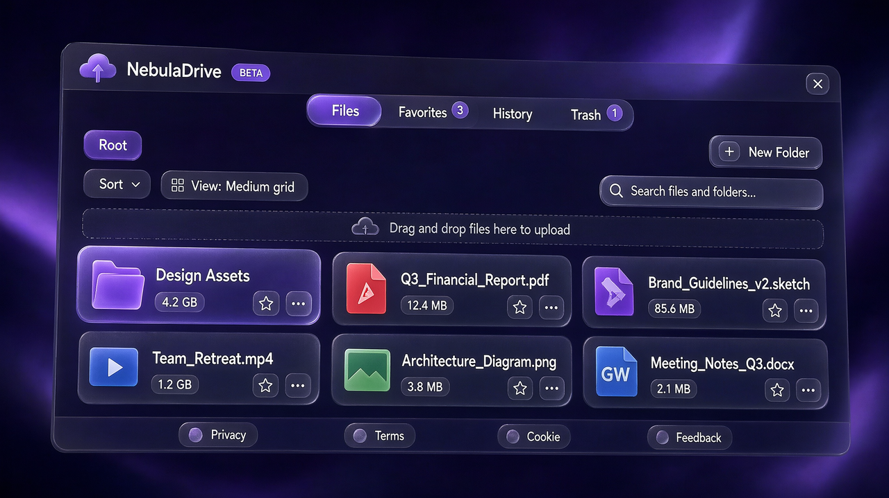

# NebulaDrive — PC



> **Illustrative preview** — a sketch of the desktop shell (dark aurora + glass,
> same palette as the web app). The real window is painted by the app itself;
> the PC app cannot be run in this sandbox, so this is a representative image,
> not a screenshot.

The desktop version of NebulaDrive. Same idea as the web app (`../index.html`):
your files stay on your PC — no servers, no subscriptions.

There are two builds, sharing one codebase:

| Target | Description | Platforms |
|---|---|---|
| **NebulaDrive** (`NebulaDrive.exe`) | The desktop app (Win32 + GDI+ UI) | Windows |
| **NebulaDriveCLI** (`NebulaDriveCLI`) | Terminal UI — a scriptable, cross-platform companion | Windows, Linux, macOS |

The library (SQLite + folder storage) is shared between both. The web app at
`../index.html` is unchanged and stays fully available.

## What it does

- 📂 Files, folders, move, rename, search (folder + file level)
- ⭐ Favourites (star/unstar)
- 🗑️ Trash with restore and a true "empty trash" (bytes + records deleted)
- 💾 Backups — timestamped copies of your whole library under `backups/`
- 📊 Stats and an activity history log
- 🔐 Local-only: everything is a plain folder (`./NebulaDriveData` or `%APPDATA%\NebulaDrive`)
  you can back up, move or hand to another machine

## Requirements

| Tool | Version |
|---|---|
| CMake | 3.22+ |
| C++20 compiler | MSVC 2022 **or** MinGW-w64 64-bit (Windows) · GCC/Clang (Linux/macOS, CLI only) |
| SQLite | bundled (`vendor/sqlite/`, amalgamation 3.54.1 — no network needed) |

> The desktop app targets Windows (Win32 API + GDI+). The CLI is portable.

## Building

### Windows (desktop app + CLI)

```powershell
# MSVC (Visual Studio 2022, "Desktop development with C++")
cmake -B build -S . -A x64
cmake --build build --config Release

# …or MinGW
cmake -B build -S . -G "MinGW Makefiles"
cmake --build build --config Release
```

Result: `build\NebulaDrive.exe` (desktop) and `build\NebulaDriveCLI.exe` (CLI).

### Linux / macOS (CLI only)

```bash
cmake -B build -S .
cmake --build build -j
```

Result: `build/NebulaDriveCLI`.

## Running

### Desktop app

```powershell
.\build\NebulaDrive.exe
```

Your library lives in `%APPDATA%\NebulaDrive` (portable installs using an
existing `NebulaDriveData` next to the exe are kept as-is).

### CLI

```bash
./NebulaDriveCLI --path ./NebulaDriveData   # optional path; this is the default
```

Run `help` inside the shell for the full command list:

```
list · import · search · mkdir · move <id> [folder] · delete · restore
favorite · backup · backups · trash · emptytrash · status · history · quit
```

## Files

```
pc/
├── CMakeLists.txt          # modern build (GUI + CLI + install rules + CPack)
├── main.cpp                # CLI entry point
├── gui_app.cpp             # desktop shell (Win32, Windows only)
├── nebula_ui.{h,cpp}       # GDI+ rendering toolkit (Windows only)
├── database.{h,cpp}        # SQLite layer (shared)
├── storage_handler.{h,cpp} # files/folders/trash/backups (shared)
├── NebulaDrive.rc          # version info
├── nebula.ico              # app icon
├── vendor/sqlite/          # vendored SQLite 3.54.1 amalgamation
├── .gitignore
└── README.md               # this file
```

## Status

- ✅ CLI builds and passes a full end-to-end run (import → folders → move →
  trash → restore → backup → empty-trash → status) on Linux — **built and
  verified with CMake + GCC 12**.
- 🖥️ Desktop app: same codebase, Win32/GDI+; designed to build on Windows
  (MSVC 2022 / MinGW 64-bit). The desktop build requires a Windows toolchain,
  so it was normalized (line endings, encoding) but not compiled in this
  environment — please build it on your Windows machine; the build files are
  tested and the shared library layer is proven.

## License

See `../LICENSE`. SQLite is in the public domain (see `vendor/sqlite/sqlite3.h`).
